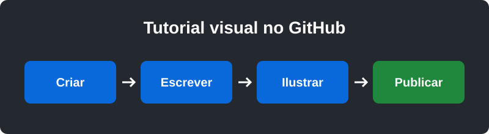
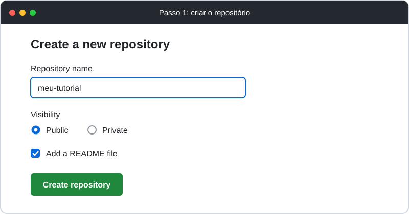
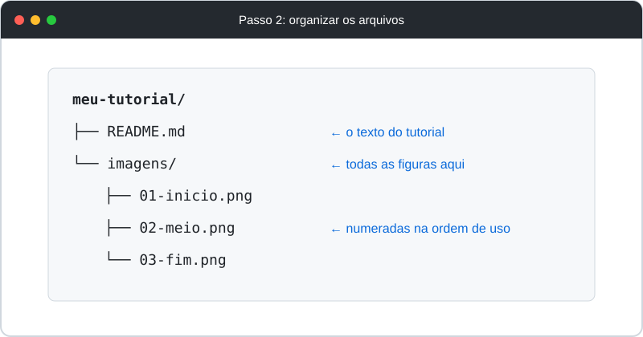
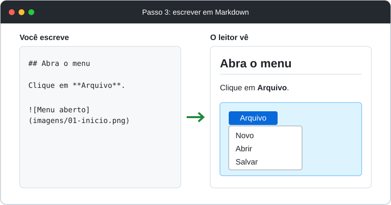
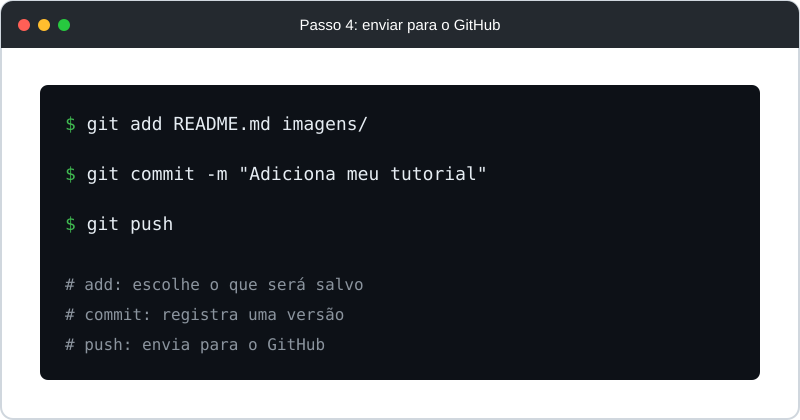
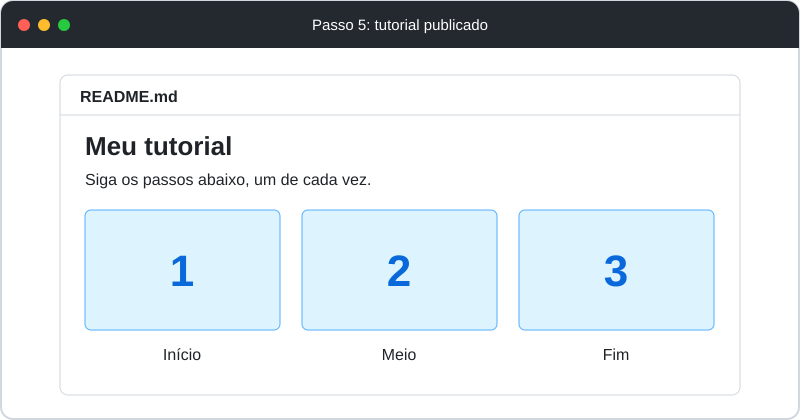

# Como é fácil fazer um tutorial visual no GitHub



Para montar um tutorial com imagens, você não precisa saber criar sites. Basta um arquivo de texto chamado `README.md` e uma pasta com figuras. O GitHub transforma os dois em uma página organizada.

> As figuras deste guia são ilustrações simplificadas. A aparência real do GitHub pode ser um pouco diferente.

## Sumário

1. [Crie o repositório](#1-crie-o-repositório)
2. [Organize os arquivos](#2-organize-os-arquivos)
3. [Escreva em Markdown](#3-escreva-em-markdown)
4. [Envie para o GitHub](#4-envie-para-o-github)
5. [Veja o resultado](#5-veja-o-resultado)

---

## 1. Crie o repositório

No GitHub, clique em **+** e depois em **New repository**. Dê um nome curto, escolha a visibilidade e marque **Add a README file**.



Escolha **Public** se qualquer pessoa puder ler, ou **Private** para restringir o acesso.

Para trabalhar no seu computador, clone o repositório (troque `SEU-USUARIO` pelo seu nome de usuário):

```bash
git clone https://github.com/SEU-USUARIO/meu-tutorial.git
cd meu-tutorial
```

## 2. Organize os arquivos

Guarde todas as figuras em uma pasta própria. Numerar os nomes mantém a ordem clara.



Prefira nomes sem espaços nem acentos, como `01-inicio.png`. Atenção às maiúsculas: no GitHub, `Foto.png` e `foto.png` são arquivos diferentes.

## 3. Escreva em Markdown

Markdown é um jeito simples de formatar texto usando poucos símbolos.



| Para fazer | Escreva |
| --- | --- |
| Título | `# Meu título` |
| Subtítulo | `## Uma etapa` |
| Negrito | `**importante**` |
| Lista numerada | `1. primeiro passo` |
| Link | `[texto](https://exemplo.com)` |
| Imagem | `` |

O texto entre colchetes de uma imagem é a **descrição alternativa**. Leitores de tela a usam, e ela aparece se a imagem não carregar.

Para controlar o tamanho de uma figura, use HTML:

```html

```

## 4. Envie para o GitHub

Com o texto e as figuras prontos, três comandos publicam tudo:



```bash
git add README.md imagens/
git commit -m "Adiciona meu tutorial"
git push
```

Prefere não usar o terminal? Na página do repositório, use **Add file → Upload files** e arraste a pasta e o `README.md`.

## 5. Veja o resultado

Abra a página do repositório. O `README.md` aparece automaticamente, já formatado.



---

## Dicas para um bom tutorial

- **Uma ação por passo.** O leitor acompanha sem se perder.
- **Texto antes da imagem.** Diga o que fazer e depois mostre.
- **Recorte as capturas de tela.** Deixe visível só o que importa. No Windows, use `Win + Shift + S`.
- **Oculte dados pessoais** como e-mails, senhas e tokens antes de publicar.
- **Teste o passo a passo** do começo ao fim, de preferência com outra pessoa.

## Modelo para copiar

```markdown
# Nome do tutorial

O que o leitor vai aprender.

## Passo 1: nome da etapa

Explique a ação em uma ou duas frases.


```
